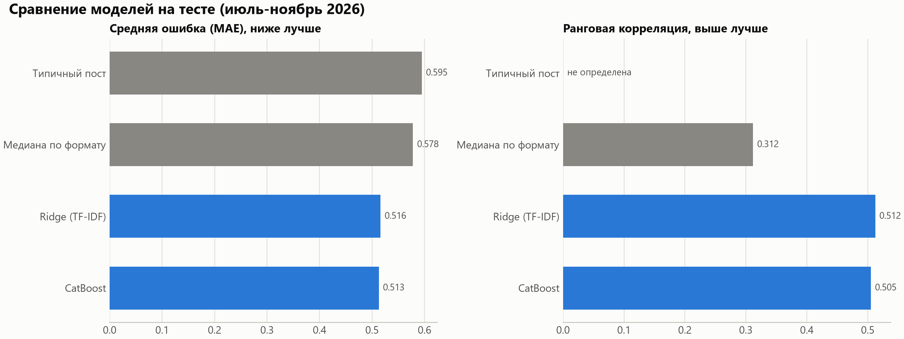
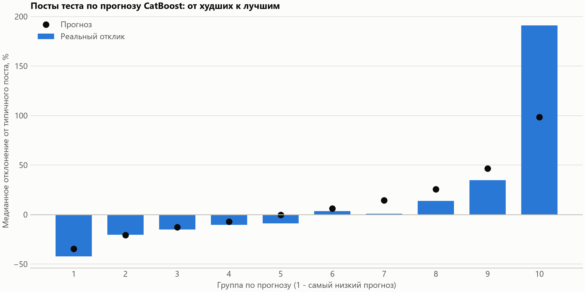
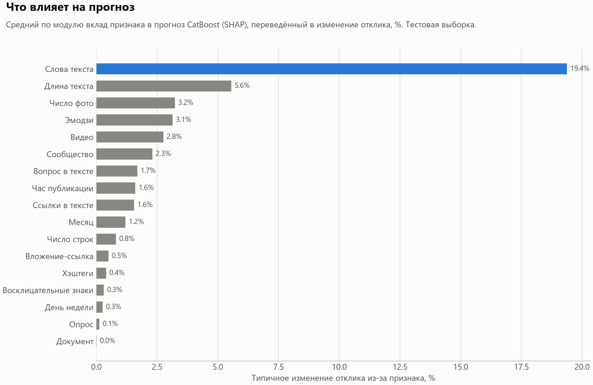
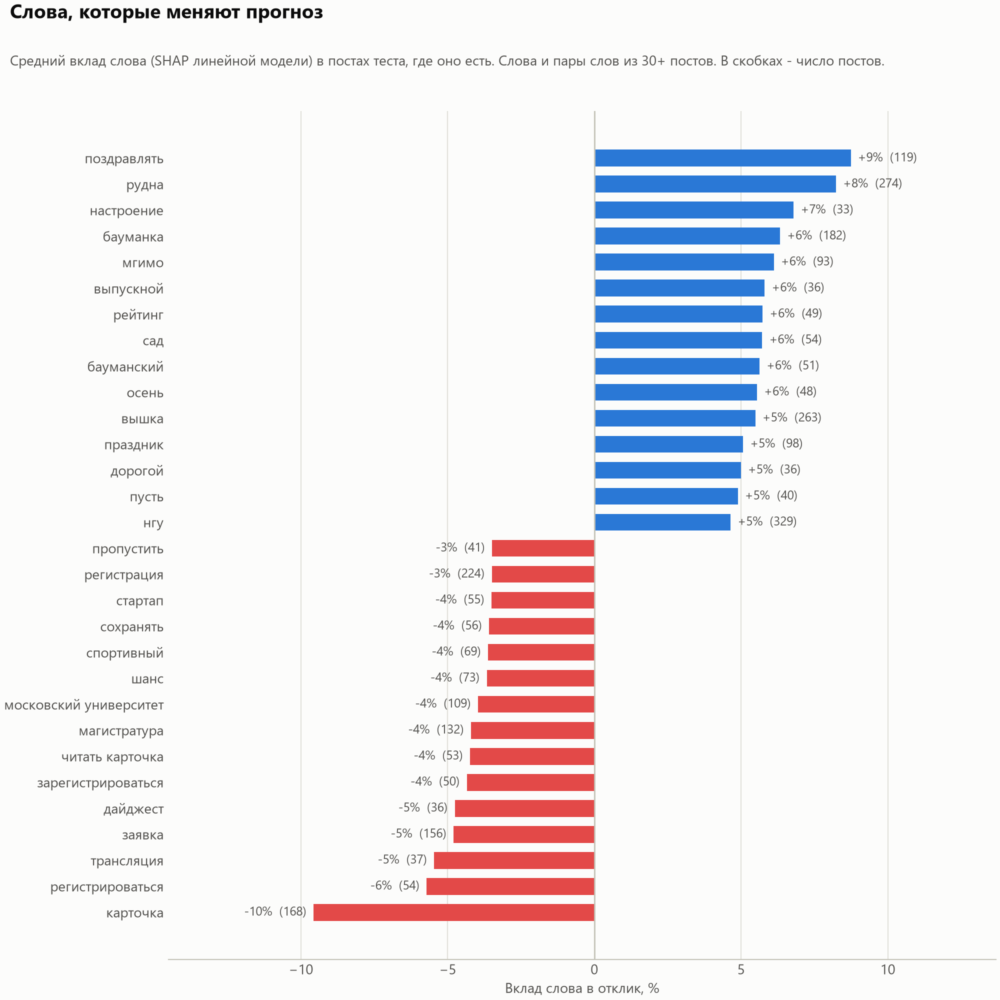

## Какой пост наберёт отклик?

Предсказание вовлечённости постов в сообществах университетов во «ВКонтакте».

Проект собирает посты 9 сообществ российских университетов за 3 года, анализирует, от чего зависит отклик аудитории, и обучает модель, которая оценивает пост до публикации и объясняет свой прогноз.

---

### Задача

Модель отвечает на вопрос: **насколько пост соберёт больше или меньше реакций, чем типичный пост этого сообщества?**

Число лайков нельзя предсказывать напрямую: оно зависит от размера сообщества и меняется со временем. Поэтому целевая переменная строится в два шага:

1. Доля реакции: лайки, делённые на просмотры.
2. Отклик относительно типичного поста: доля реакции, делённая на медиану того же сообщества за тот же месяц.

Модель предсказывает логарифм этого значения. Например, прогноз `+50%` означает, что пост соберёт в 1,5 раза больше реакций, чем типичный пост своего сообщества.

---

### Данные

Посты собраны через VK API методом `wall.get` за период с ноября 2023 по ноябрь 2026.

| Сообщество | Постов |
|---|---|
| `mephi_official` | 5163 |
| `msu_official` | 4609 |
| `nsu24` | 4208 |
| `mgimo` | 3720 |
| `bmstu1830` | 3709 |
| `hse_university` | 3587 |
| `rudn_university` | 3215 |
| `samara_university` | 2513 |
| `itmoru` | 665 |

Всего собрано 31 389 постов, после очистки осталось **28 071**. Удалены:

* репосты: у них нет собственного текста (2789);
* посты моложе 7 дней на момент сбора: их счётчики ещё растут (168);
* посты из месяцев, когда сообщество отключало лайки (381).

Сырые данные и модели хранятся локально и не входят в репозиторий.

---

### Структура проекта

| Модуль | Класс | Назначение |
|---|---|---|
| `collect_posts.py` | `VKPostsCollector` | Сбор постов с продолжением после остановки |
| `preprocess.py` | `PostsPreprocessor` | Очистка, целевая переменная, признаки, лемматизация |
| `analysis.py` | `PostsAnalyzer` | Исследовательский анализ и графики |
| `train_model.py` | `EngagementModelTrainer` | Обучение и сравнение моделей |
| `explain_model.py` | `ModelExplainer` | Объяснение моделей через SHAP |

Результаты сохраняются в папку `results`:

* `eda` — графики и сводка исследовательского анализа;
* `model` — метрики и сравнение моделей;
* `explain` — графики SHAP и вклад слов.

---

### Запуск

Токен VK API хранится в файле `lab1/.env` в переменной `API_TOKEN`. Все команды выполняются из корня репозитория:

```bash
python -m final_project.collect_posts
python -m final_project.preprocess
python -m final_project.analysis
python -m final_project.train_model
python -m final_project.explain_model
```

Если данные уже собраны, сбор повторно не запускается. Чтобы собрать их заново, удалите папку `final_project/data/raw`.

---

### Признаки

| Группа | Признаки |
|---|---|
| Текст | Леммы текста: TF-IDF для линейной модели, 64 компоненты TruncatedSVD для CatBoost |
| Оформление | Длина текста, число строк, эмодзи, хэштеги, ссылки, восклицательные знаки, вопрос в тексте |
| Вложения | Число фото, видео, ссылка, опрос, документ |
| Время | Час и день недели по местному времени сообщества, месяц |
| Сообщество | Название сообщества |

Комментарии и репосты не используются как признаки: до публикации они неизвестны, и их использование привело бы к утечке данных.

---

### Модели и результаты

Данные разбиты по времени: модель учится на прошлом и проверяется на будущем.

| Выборка | Период | Постов |
|---|---|---|
| Обучение | до марта 2026 | 21 771 |
| Проверка | март-июнь 2026 | 3485 |
| Тест | июль-ноябрь 2026 | 2815 |

Параметры моделей подбирались на проверочной выборке, тестовая использовалась один раз для итоговой оценки.

| Модель | MAE | R² | Ранговая корреляция | Знак угадан |
|---|---|---|---|---|
| Типичный пост (прогноз «как обычно») | 0,595 | −0,01 | — | 50% |
| Медиана по формату поста | 0,578 | 0,08 | 0,31 | 59% |
| Ridge на TF-IDF | 0,516 | 0,25 | **0,51** | **68%** |
| CatBoost | **0,513** | **0,26** | 0,51 | 66% |

«Знак угадан» — доля постов, для которых модель верно определила, будет отклик выше или ниже типичного.

Если разбить посты теста по прогнозу CatBoost на 10 равных групп, реальный отклик меняется от −42% в группе с самым низким прогнозом до +191% в группе с самым высоким.





---

### Что влияет на отклик

**Формат поста** (отклик относительно типичного поста, медиана):

| Формат | Отклик |
|---|---|
| Видео | +25% |
| 5 и больше фото | +8% |
| 2-4 фото | +2% |
| 1 фото | −8% |
| Ссылка без фото | −19% |
| Только текст | −28% |
| Опрос | −30% |

**Объяснение модели через SHAP:**

* Сильнее всего на прогноз влияют слова текста. Из оформления важнее всего длина текста, число фото, эмодзи и наличие видео.
* Больше реакций собирают поздравления и эмоциональные посты о жизни университета: «поздравлять», «праздник», «выпускной», неформальные названия своего вуза («бауманка», «вышка», «мгимо»).
* Меньше реакций собирают служебные анонсы: «регистрироваться», «заявка», «трансляция», «дайджест».
* Посты только с фото и без текста получают +29%, а тексты средней длины, от 400 до 1000 символов, около −5%.
* До 3 эмодзи немного помогают, 7 и больше снижают отклик на 6-9%.
* Вечерние посты, около 21 часа, получают около +7%, посты в середине дня около −1%.





---

### Выводы

* Модель хорошо упорядочивает посты от слабых к сильным, но точное число реакций предсказывает плохо: R² около 0,26. Поэтому её стоит использовать для сравнения вариантов поста, а не для точного прогноза лайков.
* Простая линейная модель на словах работает не хуже CatBoost: основной сигнал содержится в тексте.
* Влияние времени публикации слабее, чем кажется по простой статистике: вечером чаще публикуют поздравления, которые сами по себе собирают больше реакций.

### Ограничения

* Результаты показывают связи, а не причины: модель объясняет, на что она опирается, но не доказывает, что слово само вызывает реакции.
* На тесте качество немного ниже, чем на проверке (ранговая корреляция 0,51 против 0,58): поведение аудитории меняется со временем.
* Сообщество `itmoru` публикует мало, поэтому его данных меньше, чем у остальных.

---

### Технологии

Python, vk_api, pandas, NumPy, pymorphy3, NLTK, scikit-learn, CatBoost (включая расчёт SHAP-значений), Matplotlib.
